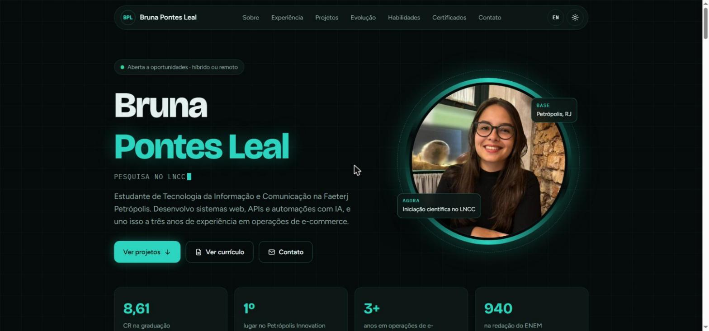

<h1 align="center">Portfólio · Bruna Pontes Leal</h1>

<p align="center">
  Meu portfólio pessoal: experiência, projetos, linha de evolução, habilidades e certificados.
</p>

<p align="center">
  <a href="https://bpontesleal-coder.github.io/"><strong>bpontesleal-coder.github.io</strong></a>
</p>

<p align="center">
  
  
  
  
</p>



## Destaques

- **Sem frameworks:** HTML, CSS e JavaScript em um único arquivo, sem etapa de build
- **Dados do GitHub ao vivo:** linguagens, repositórios e seguidores carregados pela API pública do GitHub, com cache de uma hora
- **Linha de evolução** que se preenche conforme a página é rolada
- **Português e inglês**, com troca de idioma sem recarregar a página
- **Tema claro e escuro**, respeitando a preferência do sistema
- **Currículo** que pode ser impresso ou salvo em PDF direto do navegador
- **Responsivo e acessível:** navegação por teclado, foco visível e respeito à opção de reduzir animações

## Seções

| Seção | Conteúdo |
|---|---|
| Início | Apresentação, foto e números de destaque |
| Sobre | Quem sou, objetivo, formação e painel com dados do GitHub |
| Experiência | Iniciação científica no LNCC, PLG Tecnologia e B2T |
| Projetos | Pesquisa, inovação e projetos web, com detalhes de cada um |
| Evolução | Linha do tempo, do primeiro hackathon à pesquisa científica |
| Habilidades | Tecnologias e competências com nível de uso |
| Certificados | Cursos, eventos e reconhecimentos |
| Contato | E-mail, LinkedIn e GitHub |

## Como executar

```bash
git clone https://github.com/bpontesleal-coder/bpontesleal-coder.github.io.git
```

Abra o `index.html` no navegador. O conteúdo fica nos objetos `T`, `EXP`, `PROJ`, `STEPS`, `CERTS` e `SKILLS`, dentro do próprio `index.html`: para atualizar o portfólio, basta editar esses dados.

## Contato

[LinkedIn](https://www.linkedin.com/in/bruna-pontes-leal/) · [E-mail](mailto:bpontesleal@gmail.com) · [GitHub](https://github.com/bpontesleal-coder)
